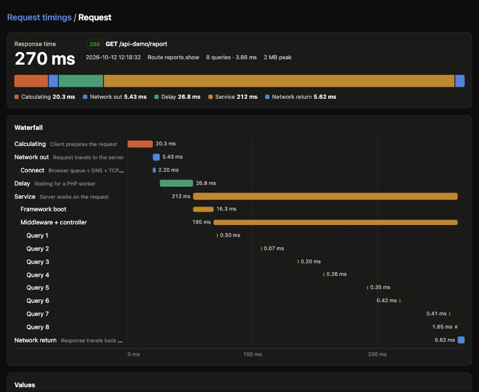

# Performance Tracking Times

A Laravel package that breaks every request's response time into its parts and shows each one as a waterfall diagram:

| Segment | What it is | Measured by |
|---|---|---|
| **Calculating** | Time the client spends preparing the request (building the payload, serialising, signing) | Client |
| **Network out** | The request travelling to the server, including connection setup (browser queue, DNS, TCP, TLS) | Client + server |
| **Delay** | Time the request waits in the web server or PHP-FPM queue before a worker picks it up | Web server + PHP |
| **Service** | Time the server works on the request: framework boot, middleware, controller, and the database queries inside it | Server |
| **Network return** | The response travelling back and downloading | Client + server |
| **Response time** | The sum of the segments above: from the client starting the work to the last byte arriving. Browser rendering afterwards is not included. | |

The dashboard at `/performance-tracking` lists recent requests with a stacked bar for each one, plus server-side and end-to-end percentiles. Open a request to see its waterfall, a table of the values, and the SQL of its queries placed on the timeline.



## Requirements

| Laravel | PHP |
|---|---|
| 10 | 8.1 – 8.4 |
| 11, 12 | 8.2 – 8.4 |
| 13 | 8.3 – 8.4 |

Tested on SQLite, MySQL 5.7 and 8.0, and PostgreSQL 16.

## Installation

```bash
composer require cofa/performance-tracking-times
php artisan migrate
```

The service provider is auto-discovered. It prepends the recording middleware to the global middleware stack, so it wraps every other middleware and route.

**Recording is on in the `local` environment only.** To record elsewhere, turn it on and sample:

```dotenv
PERFORMANCE_TRACKING_ENABLED=true
PERFORMANCE_TRACKING_SAMPLE_RATE=0.05   # 5% of requests
```

Every recorded request is one row (plus up to 50 query texts), so keep the sample rate low on busy servers and keep the timings in their own database if you like (`PERFORMANCE_TRACKING_DB_CONNECTION`).

To publish the config:

```bash
php artisan vendor:publish --tag=performance-tracking-config
```

## 1. Server side: delay and service time

This part works as soon as recording is on. Service time (framework boot plus middleware and controller) and database time are measured for every recorded request.

To measure **delay** (queue time), the web server has to stamp the time it received the request, from a source the client cannot forge. With nginx in front of PHP-FPM, use a FastCGI param (clients can only set `HTTP_*` params):

```nginx
location ~ \.php$ {
    fastcgi_param REQUEST_START_TIME "t=${msec}";
    # ...
}
```

If nginx is a reverse proxy instead (Octane, another host), use the header:

```nginx
proxy_set_header X-Request-Start "t=${msec}";
```

Because any client can send `X-Request-Start` itself, the header is honoured only on requests that came through a proxy your application trusts ([TrustProxies](https://laravel.com/docs/requests#configuring-trusted-proxies)). Set `request_start_header_trust` to `always` (`PERFORMANCE_TRACKING_TRUST_HEADER=always`) if you cannot configure trusted proxies and your web server always overwrites the header.

With Apache or LiteSpeed (cPanel and most shared hosting), add this to `public_html/.htaccess` and set `PERFORMANCE_TRACKING_TRUST_HEADER=always`, since the web server itself replaces any value a visitor sends:

```apache
<IfModule mod_headers.c>
    RequestHeader set X-Request-Start "%t"
</IfModule>
```

Stamps more than `max_delay_ms` (60 s) old are ignored. Without a stamp the dashboard shows delay as "not measured", and any queueing time is counted in network out instead.

Every recorded response carries a header the client script reads:

```
X-Request-Timing: id=<uuid>;t1=<server received, epoch ms>;t2=<response ready, epoch ms>;n=<node>
```

`n` identifies the server (a hash of the hostname, or `PERFORMANCE_TRACKING_NODE`), so clients keep a separate clock offset for each server behind a load balancer.

In `local`, responses also carry `Server-Timing`, which browser devtools show in the Network tab:

```
Server-Timing: delay;dur=8.7;desc="Queue", boot;dur=17.5;desc="Framework boot", app;dur=238;desc="Middleware + controller", db;dur=4.0;desc="8 queries", service;dur=255.5
```

Elsewhere it is off, because it tells anyone how long each request took on the server and how many queries it ran, which makes timing attacks (user enumeration on a login form, for example) far easier. Turn it on with `PERFORMANCE_TRACKING_SERVER_TIMING=true` only where that is acceptable.

## 2. Client side: calculating and network time

The server cannot measure the network legs on its own. Only the client knows when the request left and when the response finished arriving, so the client reports those timestamps back.

### Browser (Blade, Inertia, Livewire, any JS frontend)

Add the script to your layout's `<head>`, before any other script:

```blade
@performanceTrackingScript
```

It wraps `fetch` and `XMLHttpRequest` (so axios and jQuery work too), reads precise timestamps from the Resource Timing API, and sends them in batches with `navigator.sendBeacon`. It does not change your requests or their responses. The tag is a small synchronous script (so it is in place before your own scripts send requests), versioned so browsers cache it until the package changes.

On a server-rendered page, the tag also carries that page's timing id, so the **page load itself** gets network times (from the Navigation Timing API), not only the AJAX calls made after it. The first page of a visit splits network time evenly; once the browser has made an AJAX call to the same server it knows the clock offset and splits it precisely.

Pages and responses served from a cache (a CDN, a full-page cache, `Cache-Control: public`) carry the timing id of the request that produced them. The server rejects reports whose send time is far from that request when it can tell, but send tracked pages with `Cache-Control: private` if they could be cached.

For a frontend on another origin (React, Vue, Next.js, …) or a mobile app, see [section 3](#3-api-with-a-separate-frontend-or-mobile-app).

To also measure **calculating** time, wrap the work that comes before a request:

```js
await RequestTiming.measure(() => {
    const body = buildExpensivePayload();   // counted as "calculating"
    return fetch('/api/orders', { method: 'POST', body });
});

// or mark the start yourself; the next request within a minute picks it up
RequestTiming.markCalculating();
```

When the browser provides no Resource Timing entry for a `fetch` (some cross-origin setups), the script falls back to the moment the response headers arrived; such requests are marked and their network return does not include downloading the body.

## 3. API with a separate frontend or mobile app

When Laravel serves only an API and the frontend lives elsewhere (a React/Vue/Angular/Next.js app on another domain, or a Flutter/React Native/Swift/Kotlin app), three people each do one part. A printable version of this section for your developers is in [docs/frontend-setup.pdf](docs/frontend-setup.pdf).

### On the API (API owner, once)

1. Name the frontend's address in the API's `.env`, so browsers there may read the timing header. Separate several frontends with commas. Mobile apps need nothing here.

   ```dotenv
   PERFORMANCE_TRACKING_ALLOW_ORIGIN=https://app.example.com
   ```

2. Reload the configuration with `php artisan config:clear`.
3. The frontend must already be allowed by the API's CORS settings (`config/cors.php`, `allowed_origins`). If it can call the API today, it is.

### Web frontend (web developer)

Add one tag to the HTML template's `<head>`, before the app's own scripts. It wraps `fetch` and `XMLHttpRequest`, so axios, ky, jQuery and plain `fetch` are all covered, and the app's API calls stay as they are.

```html
<script src="https://api.example.com/performance-tracking/client.js"
        data-endpoint="https://api.example.com/performance-tracking/api/client"></script>
```

With Next.js, add it to the root layout with `next/script`:

```tsx
<Script
  src="https://api.example.com/performance-tracking/client.js"
  data-endpoint="https://api.example.com/performance-tracking/api/client"
  strategy="beforeInteractive"
/>
```

- If the site sends a Content-Security-Policy, allow the API's domain in `script-src`.
- To measure calculating time, wrap the work before a request in `RequestTiming.measure()` (see above). In TypeScript, guard it so the app still works when an ad blocker blocks the script:

  ```ts
  export const measure = <T,>(fn: () => T): T =>
    window.RequestTiming ? window.RequestTiming.measure(fn) : fn();
  ```

Page loads of a separate frontend are not reported, only its API calls: the page itself does not come from Laravel, so it has no timing id.

### Mobile app (mobile developer)

There is no script to load, so the app reports the timestamps itself with a small wrapper around its HTTP client:

1. Before the call, note the time in epoch milliseconds (`t0`).
2. After the response, note the time again (`t3`) and read the `X-Request-Timing` header: `id=…;t1=…;t2=…;n=…`. Not every response has it (the server samples), so skip those without.
3. Per server `n`, keep the clock offset from the fastest exchange: `((t1 - t0) + (t2 - t3)) / 2`, where fastest means the smallest `(t3 - t0) - (t2 - t1)`. Refresh it every 10 minutes.
4. Every few seconds (or at 20 entries), and when the app goes to the background, POST up to 50 entries as JSON to `/{path}/api/client` (`/performance-tracking/api/client` by default).

Ready-made wrappers: [Flutter](docs/clients/request_timing.dart) and [React Native / JavaScript without a page](docs/clients/requestTiming.ts). Swift and Kotlin follow the same four steps.

The report format:

```json
{
  "timings": [{
    "id": "<id from X-Request-Timing>",
    "t0": 1791807203600.12,
    "t3": 1791807203910.55,
    "calc_ms": 12.5,
    "connect_ms": 3.1,
    "offset_ms": -4.2,
    "headers_only": false
  }]
}
```

- `t0` is when the request was sent and `t3` is when the response finished arriving, both in epoch milliseconds on the client clock. Both are required.
- `calc_ms`, `connect_ms`, `offset_ms` and `headers_only` are optional. Set `headers_only` when `t3` is when the headers arrived rather than the whole body.
- Without `offset_ms`, the network time is split evenly between the two directions.
- Send up to 50 timings per call, within 10 minutes of the request. Each request accepts one report. Invalid or implausible entries are skipped without affecting the rest; the response says how many were `accepted` and `rejected`.
- Reports are rate limited to 120 per minute per IP address and 10 000 per minute in total (`client_rate_limit`). Behind a load balancer, configure TrustProxies, or every client shares the balancer's address.

### Check that it works

1. **The header is there.** In the browser's devtools (Network tab), an API response has an `X-Request-Timing` header, and for a web frontend also `Access-Control-Expose-Headers: X-Request-Timing`. Only sampled requests carry it, so check a few. From a terminal:

   ```bash
   curl -s -D - -o /dev/null -H "Origin: https://app.example.com" https://api.example.com/api/your-endpoint | grep -i -E 'x-request-timing|access-control-expose-headers|timing-allow-origin'
   ```

2. **Reports are sent.** About two seconds after a call, a request to `/performance-tracking/api/client` answers with `accepted` above 0.
3. **The dashboard fills in.** Rows without a `*` have client timings.

Don't cache API responses publicly (`Cache-Control: public`, a CDN cache): a cached response carries another request's timing id, and its reports are rejected.

## How the network split works

```
client   t0 ──── network out ────▶                              ◀──── network return ──── t3
server                            t1 ─ delay ─ boot ─ app ─ t2
```

- `(t3 − t0) − (t2 − t1)` is the total time on the wire. It does not depend on the client and server clocks agreeing.
- Splitting that total into the out and return legs does depend on the clocks. The client keeps, per server, the clock offset measured on its fastest exchange (the NTP offset formula) and sends it with each report. The server uses it to place `t1` and `t2` on the client's clock. The estimate is off by half the difference between the two legs of that fastest exchange.
- If the offset drifts, a leg is clamped at zero so the total stays correct.
- `t2` is when the response was ready to send. For streamed and file responses the body is produced while it is sent, so that time falls inside network return; the waterfall shows it separately.

## Dashboard

The dashboard updates itself while it is open: every 5 seconds (`PERFORMANCE_TRACKING_REFRESH_SECONDS`, 0 turns it off) it fetches the latest requests, new rows appear at the top, and a row is highlighted again when its client report arrives. It pauses while the tab is in the background and has a Pause button. Older pages (`?page=2` and on) stay still, so rows do not shift while you read them. A request's page refreshes until its client report arrives, then stops.

It polls instead of keeping a connection open, so it works on any hosting, shared hosting included, without a WebSocket server.

### Access

In the `local` environment the dashboard is open to anyone. Everywhere else, define a gate:

```php
// App\Providers\AppServiceProvider::boot()
Gate::define('viewPerformanceTracking', fn ($user) => $user->is_admin);
```

## Stored data and privacy

Each row holds the method, the path, the route name, the status, the timings and, unless disabled, the authenticated user's id and the query SQL.

- **Paths** are stored as the matched route's URI (`/reset/{token}`), so tokens and ids in URLs never reach the table. Requests that matched no route keep their raw path. Set `path_mode` to `raw` to store paths as requested.
- **IP addresses** are not stored unless `store_ip` is true.
- **User ids** are stored when someone is already signed in (`store_user_id`); the package never triggers authentication to find out.
- **SQL** is stored as Laravel sent it: with placeholders, never the bindings. Values written into the SQL itself (raw expressions, `whereIntegerInRaw`) are stored as written. Set `record_queries` to false to keep only the totals.

## Configuration highlights

| Key | Default | |
|---|---|---|
| `enabled` | `true` in `local` only | `PERFORMANCE_TRACKING_ENABLED` |
| `sample_rate` | `1.0` | Record this fraction of requests; lower it on busy servers |
| `path` | `performance-tracking` | Dashboard URL prefix |
| `dashboard_refresh_seconds` | `5` | `PERFORMANCE_TRACKING_REFRESH_SECONDS`; 0 turns live updates off |
| `expose_server_timing` | `true` in `local` only | `PERFORMANCE_TRACKING_SERVER_TIMING` |
| `request_start_server_param` / `request_start_header` | `REQUEST_START_TIME` / `X-Request-Start` | Where the web server's receive stamp comes from |
| `request_start_header_trust` | `proxies` | `PERFORMANCE_TRACKING_TRUST_HEADER`: `proxies`, `always` or `never` |
| `ignore_paths` / `ignore_methods` | telescope, horizon, … / `OPTIONS`, `HEAD` | |
| `path_mode` / `store_ip` / `store_user_id` | `route` / `false` / `true` | See above |
| `record_queries` / `query_limit` | `true` / `50` | |
| `timing_allow_origin` | `null` | Set it when the frontend runs on another origin, so the browser exposes the header |
| `client_rate_limit` | 120 per IP, 10 000 total, per minute | |
| `connection` / `table` | default / `performance_timings` | Keep timings in a separate database if you like |
| `retention_hours` / `prune_schedule` | `48` / `17 * * * *` | |

## Pruning

The prune command is scheduled hourly (`prune_schedule`), so old rows are deleted as long as your application runs `php artisan schedule:run`. It deletes in batches of 5 000 rows to keep each statement short. Set `prune_schedule` to `null` to schedule it yourself:

```php
// Laravel 11+: routes/console.php
Schedule::command('performance-tracking:prune')->hourly();

// Laravel 10: app/Console/Kernel.php, in schedule()
$schedule->command('performance-tracking:prune')->hourly();
```

## Notes

- Timings are written in the middleware's `terminate` step. Under PHP-FPM and Octane that runs after the response has been sent, so storing them does not delay the response, although the worker is busy until the insert finishes. Under other SAPIs (Apache mod_php, `php artisan serve`) the connection may stay open until the insert is done.
- Under Octane the recorder is scoped per request, and on PHP 8.2+ peak memory is reset per request (PHP 8.1 cannot reset it, so long-running workers there report the worker's peak). The PHP start time is the later of `REQUEST_TIME_FLOAT` and `LARAVEL_START`, so a long-lived worker's boot time is not counted against a request.
- Full-page navigations are reported only for pages that include `@performanceTrackingScript` (it carries the page's timing id). A frontend on another origin reports its `fetch`/XHR calls.

## Upgrading

From 1.x:

- Recording and `Server-Timing` are now off outside `local` by default; set `PERFORMANCE_TRACKING_ENABLED=true` to keep recording.
- Run `php artisan migrate` for the new columns and indexes.
- `X-Request-Start` is only trusted behind a trusted proxy. With nginx and PHP-FPM, switch to `fastcgi_param REQUEST_START_TIME "t=${msec}";`, or set `request_start_header_trust` to `always`.
- Paths are stored as route templates and IP addresses are no longer stored; see "Stored data and privacy" to change that.
- The client report endpoint's throttle is now the `performance-tracking` rate limiter. If you published the config, change `client_middleware` to `['throttle:performance-tracking']`.

## Testing

```bash
composer test       # PHPUnit; TEST_DB=mysql or TEST_DB=pgsql with DB_HOST, DB_PORT, ... for other databases
composer test:js    # the browser client, with Node's built-in test runner
```

## License

MIT
